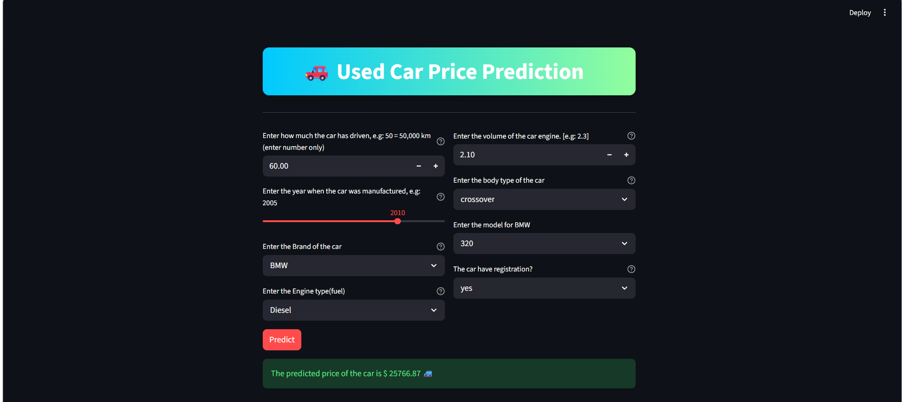

# 🚗 Used Car Price Prediction 


## Overview
A Machine Learning web application that predicts the estimated price of a used car based on features such as brand, model, mileage, engine volume, fuel type, registration status, and manufacturing year.


## Application Preview




## Features
- Data cleaning and preprocessing
- Handling missing values and outliers
- Exploratory Data Analysis (EDA)
- Feature engineering and categorical encoding
- Correlation analysis and feature selection
- Model training using Linear Regression and Random Forest Regressor
- Hyperparameter tuning with RandomizedSearchCV
- Model evaluation and performance comparison
- Interactive Streamlit web application
- Real-time used car price prediction


## Tech Stack
- Python
- NumPy
- Pandas
- Matplotlib
- Seaborn
- Scikit-Learn
- Joblib
- Streamlit


## Project Structure
The project contains the following main files and folders:

* **Data/** – Contains the raw and cleaned datasets used for training and analysis.

  * `Car_Raw_Data.csv`
  * `Car_preproccesed.csv`
  * `Car_cleaned.csv`
  * `Car_cleaned_with_Model.csv`

* **1_1Data_Cleaning_Car_drop_Model.ipynb** – Data cleaning and preprocessing notebook without the model feature.

* **1__2Data_Cleaning_Car_with_Model.ipynb** – Data cleaning and preprocessing notebook including the model feature.

* **2_Checking_Assumptions_EDA.ipynb** – Exploratory Data Analysis (EDA), feature relationships, correlation analysis.

* **Linear_Regression.ipynb** – Linear Regression model training and evaluation.

* **Random_Forest_Model.ipynb** – Random Forest model training, hyperparameter tuning, and evaluation.

* **rf1_base_rf.pkl** – Saved Random Forest model used by the web application.

* **main.py** – Streamlit application file for user interaction and price prediction.

* **requirements.txt** – List of required Python libraries.

* **README.md** – Project documentation and usage instructions.


## Usage
To predict a used car price:
- Enter the car Mileage, Engine Volume (EngineV), and Manufacturing Year.
- Select the car Brand, Body Type, Engine Type (Fuel Type), and Registration Status.
- Choose the corresponding Model for the selected brand.
- Click **Predict** to get the estimated used car price.


## Installation
1. Clone the repository.

```bash
git clone <repository-url>
cd Car_Price_Prediction
```

2. Install the required dependencies.

```bash
pip install -r requirements.txt
```

3. Run the Streamlit application.

```bash
streamlit run main.py
```

---

## Live Demo


